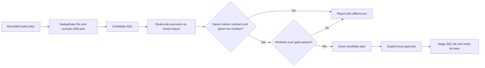

# Governed Query Optimizer

A SQL rewrite evaluation lab that checks whether a candidate preserves the answer before considering cost. It rejects unsafe changes, keeps modeled estimates separate from warehouse measurements, and stages only an approved candidate. The public BigQuery experiment preserved results but found no scan reduction.

**Author:** [Amir Ebrahim](https://www.linkedin.com/in/amirebrahim/) · Senior Analytics Engineer

Shortening a date range, dropping repeated rows or filling nulls can reduce a scan while quietly changing a business metric. A compiler check and a lower byte estimate do not catch that. This project makes correctness a prerequisite for considering the cost improvement.

The default lab runs SQL against a frozen SQLite fixture with synthetic query history and byte estimates. A separate [BigQuery experiment](benchmarks/bigquery/README.md) adds warehouse dry-run estimates, actual uncached job statistics and duplicate-sensitive comparisons on a frozen public-data snapshot.

## Start here

**Measured public-data result:** [native BigQuery result and method](examples/bigquery-measurement-2026-10-06.md). Six uncached jobs return the same 10,123-row typed multiset. Both versions process 5,894,360 bytes; the experiment finds no scan reduction.

| Reader | Useful starting point |
|---|---|
| Recruiter or hiring manager | The [result table](#what-the-demonstration-proves) below; the [generated demonstration report](examples/demo-report.json) is the raw evidence |
| Analytics engineer | [Original revenue query](src/governed_query_optimizer/fixtures/original_revenue.sql), [preaggregated candidate](src/governed_query_optimizer/fixtures/preaggregate.sql), and [result comparison](src/governed_query_optimizer/engine.py) |
| Data/platform engineer | [Approval-bound staging](docs/design.md), [negative-path tests](tests/test_engine.py) and [CI](.github/workflows/ci.yml) |

## What the demonstration proves

| Candidate | Same answer? | Scan change (modeled unless marked measured) | Verdict and why |
|---|---|---|---|
| Preaggregate item values before joining order headers | Yes: 5 of 5 rows | −87.5% | **Eligible.** Keeps the original date cohort and itemless orders |
| Remove historical dates | No: 1 row missing | −93.75% | **Blocked.** Less data is not an equivalent optimization |
| Add `DISTINCT` to repeated item values | No: 8 rows become 7 | −87.5% | **Blocked.** Repeated values are separate items |
| Replace `NULL` with a sentinel | No: 5 of 8 rows changed | −87.5% | **Blocked.** Missing and default values mean different things |
| Equivalent rewrite with no modeled saving | Yes: 5 of 5 rows | 0%; the gate requires 50% | **Blocked.** Correctness and benefit are separate gates |
| Execute a write statement | Not run | Not applicable: rejected before execution | **Blocked** by the read-only evaluator before any mutation |
| **Measured on BigQuery:** a preaggregation of the same kind on public data (different query and schema) | Yes: one 10,123-row typed multiset across six uncached jobs | **0%**: both process 5,894,360 bytes | **No saving found.** Results matched; three samples per query |

The first six rows run on the SQLite fixture, and their scan changes are synthetic inputs to the decision policy. The last row is the [measured experiment](examples/bigquery-measurement-2026-10-06.md).



## Run it

Python 3.12 or newer. The runtime uses the standard library and needs no cloud account, database server or model API key.

```text
python -m pip install -e ".[dev]"
python -m governed_query_optimizer demo --output artifacts/demo
python -m pytest -q
```

Use a virtual environment. The output directory must be new: completed evidence is preserved rather than overwritten.

The demo prints one `ELIGIBLE` candidate and five `BLOCKED` candidates, writes `report.json` and creates an unapproved `safe_plan.json`.

### Review and stage one candidate

```text
python -m governed_query_optimizer plan preaggregate --output artifacts/review/plan.json
python -m governed_query_optimizer approve --plan artifacts/review/plan.json --actor demo-reviewer --output artifacts/review/approval.json
python -m governed_query_optimizer stage --plan artifacts/review/plan.json --approval artifacts/review/approval.json --output artifacts/staged-query
```

Read the plan before approving it. Approval covers its exact SQL, fixture hashes, case contract and evaluation; changing any of those invalidates it. Staging writes a local SQL file and verifies the bytes read back. The approval file is a local attestation.

To inspect a rejected candidate:

```text
python -m governed_query_optimizer evaluate short_window
```

## Engineering decisions

- **A row multiset instead of `EXCEPT DISTINCT` alone.** The same value can legitimately occur more than once. A `Counter` compares typed rows and occurrence counts, retaining duplicates and distinguishing nulls from substitutions.
- **An explicit output contract.** Column names and order must match. Values compare exactly, including integer versus floating-point type. Monetary examples use integer cents, so no hidden tolerance changes financial meaning.
- **One frozen input state.** Original and candidate read the same in-memory fixture.
- **A read-only execution boundary.** SQLite's authorizer allows reads only from the two fixture tables and a small set of deterministic aggregate/scalar functions. Writes, schema access, database attachment and unapproved functions fail. Row and execution budgets bound candidate evaluation.
- **No double-counted query history.** Repeated job IDs are deduplicated; conflicting repeats fail. Child jobs and failed/incomplete records are excluded. A fixture-supplied logical workload ID groups recurring jobs.
- **Separate evidence types.** Evaluated rows are executable proof; supplied bytes are synthetic estimates.
- **Approval survives only unchanged inputs.** Staging re-evaluates and re-hashes the plan against the current packaged case, so an eligibility field cannot be edited to bypass the evaluator.

## Tests and reproducible evidence

The suite covers expected candidate verdicts, duplicate loss, null changes, column/type contracts, reordered rows, write and metadata access, nondeterministic functions, multi-statement input, query budgets, invalid estimates, cost increases, modified approvals, replay prevention and parent/child job double counting. [CLI tests](tests/test_cli.py) exercise the full demo and explicit approval/staging sequence.

[CI](.github/workflows/ci.yml) runs the same offline tests and demonstration on Python 3.12 and 3.14 without secrets. [Examples](examples/) contains output generated by the repository commands.

## BigQuery experiment and extension

The [BigQuery experiment](benchmarks/bigquery/README.md) compares a fixed original/preaggregation pair in the target dialect on the same time-travel snapshot, distinguishing estimated, processed and billed bytes.

Candidates can be authored by an analyst, a rule engine or an AI tool; the demonstration's preaggregation rewrite is small enough to inspect completely. A warehouse adapter would keep the same contract and add a consistent source snapshot, target-dialect compilation, approved numeric tolerances, trusted identity and least-privilege credentials; [design notes](docs/design.md) list the open questions.

## Repository map

```text
src/governed_query_optimizer/
  engine.py       result comparison, cost policy, job intake, plan/staging guards
  cli.py          demo, evaluate, plan, approve and stage commands
  fixtures/       invented orders/items, recorded proposals and synthetic job history
benchmarks/bigquery/  measured public-data experiment
tests/            engineering and command-flow regression cases
examples/         generated public demonstration evidence
docs/design.md    contracts, state transitions and production adaptation questions
```

The design is inspired by warehouse performance investigations and governed analytics delivery. This implementation and its fixtures were written for this project; no employer SQL, identifiers, reports, credentials or data are included. Code is provided under the [MIT license](LICENSE).

Related work: [analytics warehouse](https://github.com/PharaohFresh/analytics-engineering-portfolio) · [governed delivery and lineage](https://github.com/PharaohFresh/agentic-analytics-delivery) · [revenue reconciliation](https://github.com/PharaohFresh/revenue-reconciliation-pipeline).
